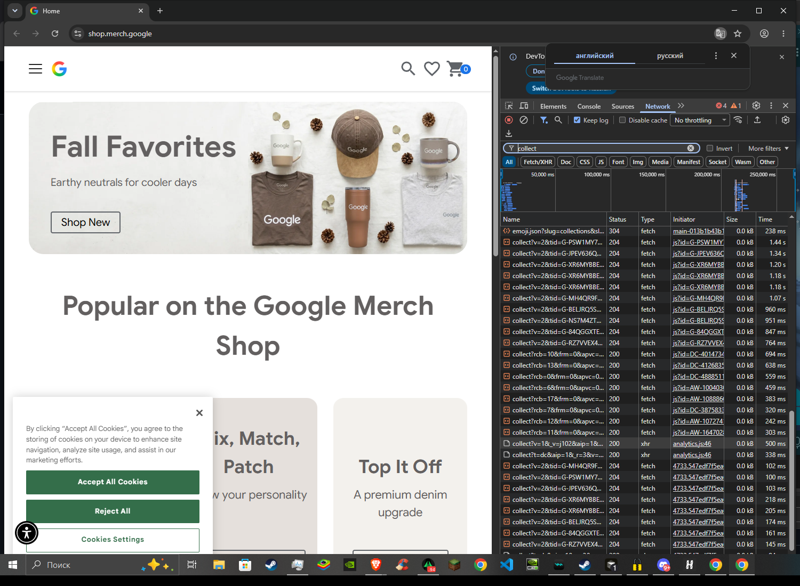
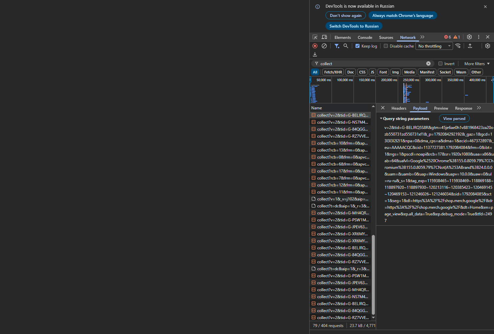

# Домашняя работа № 1 · Путь данных от ссылки до заявки

**Дисциплина:** ОП.03 «Информационные технологии»

| Поле | Значение |
|---|---|
| Фамилия, имя, отчество | Груздев Николай |
| Группа | РПО25/2 |
| Номер работы | 1 |
| Тема работы | Цифровая воронка: путь данных от ссылки до заявки |
| Дата сдачи | 15.10 |
| Ветка | `hw-01` |

---

## Задание

1. Открыть сайт, панель разработчика (F12) → **Network**, в фильтре `collect`,
   галочка **Preserve log**.
2. Сделать три действия: обновить страницу, прокрутить до низа, нажать
   на товар. Записать, какие события ушли - параметр `en` на вкладке **Payload**.
3. Описать путь пользователя от ссылки до заявки, пять шагов.
4. Найти одно место на этом пути, где данные могут потеряться.
5. Приложить скриншоты `screens/01-network.png` и `screens/02-payload.png`.

Сайт: https://shop.merch.google/, запасные - https://habr.com/ru/,
https://www.smashingmagazine.com/, https://css-tricks.com/. Открывать
в Chrome или Edge с выключенным блокировщиком рекламы.

Срок - до начала занятия 2. Ветка `hw-01`, запрос на слияние в свою `main`.

---

## 1. Какой сайт смотрел

| Поле | Значение |
|---|---|
| Название сайта | Google Merch Shop |
| Адрес | https://shop.merch.google/ |
| Откуда сайт | из списка в задании |

## 2. Три действия и что отправил счётчик

Панель Network, фильтр `collect`, галочка Preserve log (в этой версии Chrome она называется Keep log). Название события лежит в параметре `en` на вкладке Payload.

Фильтр `collect` показывает и настоящие вызовы счётчика, и лишние адреса, где эти буквы входят в другое слово, например `collections`. События ниже взяты из запросов на `region1.analytics.google.com/g/collect` и `www.google.com/ccm/collect`.

| № | Что я сделал на сайте | Название события (`en`) | Что ещё было в Payload |
|---|---|---|---|
| 1 | обновил главную страницу | `page_view` | `dl` = `https://shop.merch.google/`, `dt` = `Home`, `tid` счётчика, например `G-PSW1MY7HB4`. Таких запросов несколько: у магазина сразу несколько ресурсов аналитики |
| 2 | прокрутил главную до низа | `scroll` | `epn.percent_scrolled` = `90`, `dl` остаётся адресом главной. Событие уходит, когда страница прокручена примерно на 90 процентов |
| 3 | открыл раздел New и нажал на товар Google Mocha Organic Tee | `view_item_list` | каталог `https://shop.merch.google/shop/new` отправил просмотр списка товаров. Отдельного `en=select_item` или `en=click` в запросах `collect` после нажатия на карточку не было |

Скриншоты:

На втором кадре открыт запрос `collect` счётчика `G-BELJRQ5S8R`. В строке параметров видны `tid`, `dl` с адресом `https://shop.merch.google/`, `dt=Home` и `en=page_view`.

## 3. Путь пользователя: 5 шагов

От ссылки до заявки, своими словами. На этом магазине заявка выглядит как заказ, отдельной формы с именем и телефоном на главной нет.

| № | Мой шаг | Пример |
|---|---|---|
| 1 | человек получает ссылку на магазин и нажимает её | *человек увидел ссылку в сообществе и нажал на неё* |
| 2 | открывается главная https://shop.merch.google/, счётчик отправляет `page_view` | *открылась главная страница сайта* |
| 3 | он листает витрину вниз, уходит событие `scroll` | *он прокрутил до формы записи* |
| 4 | открывает раздел New и нажимает на товар, например Google Mocha Organic Tee | *начал заполнять: имя и телефон* |
| 5 | кладёт товар в корзину и оформляет заказ. Пока кнопка заказа не нажата, заявки нет | *нажал «Отправить», заявка ушла менеджеру* |

## 4. Где данные могут потеряться

| № | На каком шаге | Что может потеряться |
|---|---|---|
| 1 | шаг 2, загрузка страницы | сайт сразу показывает баннер cookies. Если нажать Reject All, запросы `collect` в аналитику могут не уйти, и визита `page_view` в отчёте не будет |
| 2 | шаг 1, переход по ссылке | в адресе, который я открывал, нет меток источника. Тогда в отчёте визит выглядит как прямой заход, и по заявке не видно, из какого сообщения человек пришёл |

## 5. Использование ИИ

| Вопрос | Ответ |
|---|---|
| Что сделал сам | открыл https://shop.merch.google/ в Chrome, принял cookies, обновил страницу, прокрутил вниз, открыл раздел New и товар, смотрел панель Network с фильтром collect и вкладку Payload |
| Что спросил у модели | как разложить параметры `en`, `dl`, `dt`, `tid` и собрать текст бланка по этим запросам |
| Что после этого изменил | пример из бланка убрал. В таблицу попали только события, которые реально были в запросах: `page_view`, `scroll`, `view_item_list` |
