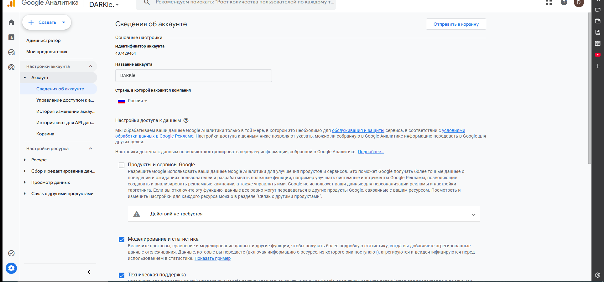
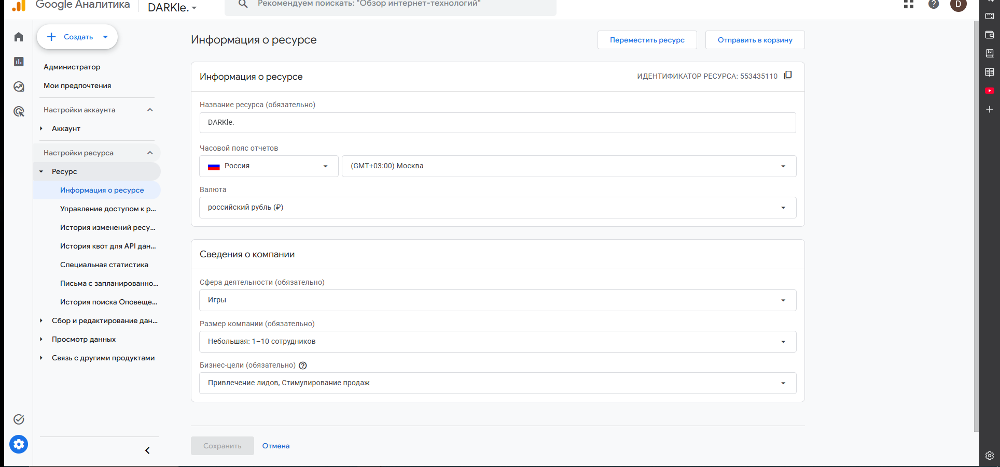
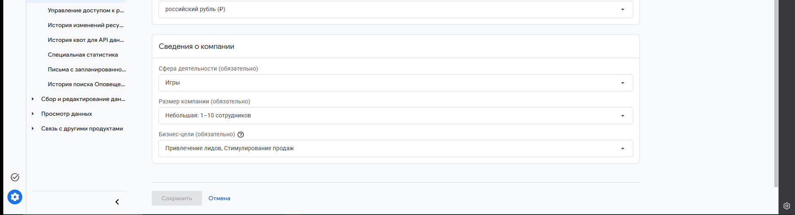
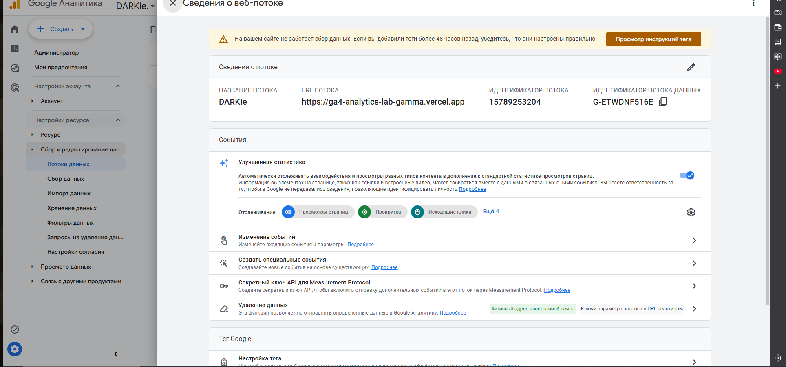

# Домашняя работа № 2 · Где бизнес теряет клиентов

**Дисциплина:** ОП.03 «Информационные технологии»

| Поле | Значение |
|---|---|
| Фамилия, имя, отчество | DARKle |
| Группа | 2 курс |
| Номер работы | 2 |
| Тема работы | Анализ воронки цифрового продукта и структура Google Analytics 4 |
| Дата сдачи | 15.10.2026 |
| Ветка | `hw-02` |

---

# Часть 1. Исследование воронки

## 1.1. Объект исследования

| Поле | Значение |
|---|---|
| Компания, сервис или отрасль | Интернет-магазин одежды Zolla, бренд компании Factor |
| Адрес сайта или приложения | https://zolla.com |
| Целевое действие | Оформленный заказ |
| Почему выбран этот объект | По магазину есть открытый разбор пути от главной до корзины и чекаута, с цифрами по отказам, поиску и переходам в корзину. Рядом есть рыночные исследования брошенных корзин, поэтому потери можно сверить не только со словами агентства |

## 1.2. Воронка

| № | Этап | Что считается переходом дальше | Метрика этапа |
|---|---|---|---|
| 1 | Переход на сайт из поиска, рекламы или прямой ссылки | Человек остался на сайте и открыл каталог или меню, а не закрыл вкладку | Сеансы и показатель отказов на главной |
| 2 | Каталог и поиск | Открыта карточка товара | Доля сеансов с просмотром выдачи поиска и доля тех, кто пользуется фильтром |
| 3 | Карточка товара | Товар добавлен в корзину или есть переход в корзину | Число переходов в корзину с карточки |
| 4 | Корзина | Нажато продолжение оформления, выбран город и способ получения | Доля корзин, из которых начато оформление |
| 5 | Оформление заказа | Заполнены контакты, выбраны доставка и оплата, заказ подтверждён | Доля начатых оформлений, которые стали заказом |
| 6 | Заказ | Заказ создан. Оплата на сайте или при получении, если этот способ включён | Конверсия сеансов в заказы |

## 1.3. Источники

### Источник 1

| Поле | Значение |
|---|---|
| Название материала | Увеличили конверсию на 97% в интернет-магазине одежды бренда Zolla |
| Автор или организация | KISLOROD, заказчик Zolla (Factor) |
| Дата публикации | 11 октября 2024 |
| Прямая ссылка | https://ratingruneta.ru/cases/case-13989/ |

**Выписка из материала** (ключевая мысль, цифра, наблюдение, результат):

> Показатель отказов на главной странице составлял 40%. По запросу «платье» поиск показывал 14 товаров, хотя в каталоге их более 100. Фильтром каталога пользовались в среднем 16% посетителей. После доработки карточки число переходов в корзину выросло на 43%. Общий показатель конверсии сайта в заказы вырос более чем на 97%. Конверсия после взаимодействия с поиском выросла в 4,66 раза.

**Что подтверждает и как связано с моей воронкой** (своими словами):

> Это прямой разбор того же магазина. Потери сидят не в одном месте: главная отсекает людей сразу, поиск не доводит до карточки, а карточка слабо переводит в корзину. Чекаут отдельно теряет тех, кто уже ввёл контакты и только потом увидел цену доставки.

**Цифры из источника и этап воронки, к которому относятся:**

> 40% отказов: этап 1, главная. 14 товаров в поиске против более 100 в каталоге и рост конверсии поиска в 4,66 раза: этап 2. 16% пользуются фильтром: этап 2. Плюс 43% переходов в корзину: этап 3. Плюс 97% конверсии сайта в заказы: этап 6. Базовая конверсия в процентах до правок в тексте не названа.

### Источник 2

| Поле | Значение |
|---|---|
| Название материала | Почему покупатели бросают корзины в интернет-магазинах: исследование RetailCRM и ЮKassa |
| Автор или организация | Яна Сонина, редакция RetailCRM, совместно с ЮKassa |
| Дата публикации | Опрос ЮKassa с 30 июля по 6 августа 2024. День выхода статьи на странице отдельно не указан |
| Прямая ссылка | https://www.retailcrm.ru/blog/posts/issledovanie-o-broshennoy-korzine |

**Выписка из материала:**

> Аналитики RetailCRM смотрели 313 интернет-магазинов с правилом «Брошенные корзины». ЮKassa опросила более 1300 человек. 18% не заканчивают оформление одежды и обуви. 30% используют корзину как список желаний. 29% бросают корзину, потому что ждут зарплату или перевод. 17% не устраивает срок доставки. 8% уходят, если во время оформления сайт работает с ошибками. Если снизить цену, 26% готовы закончить заказ. С брошенными корзинами работают 71% магазинов.

**Что подтверждает и как связано с моей воронкой:**

> В кейсе Zolla тоже написано, что корзиной пользуются как списком желаний и оформляют только часть. Исследование показывает, что это не частная ошибка одного сайта: на этапах корзины и оформления одежду бросают часто, и часть отказов связана с ценой, сроком доставки и сбоем формы, а не с тем, что товар не понравился.

**Цифры из источника и этап воронки:**

> 18% бросают оформление одежды и обуви: этапы 4 и 5. 30% держат корзину как список желаний: этап 4. 29% ждут деньги и 26% вернутся при скидке: этап 5, перед оплатой. 17% не устраивает срок доставки: этап 5. 8% уходят из-за ошибок сайта: этап 5. 71% магазинов уже делают напоминание о брошенной корзине: это ответ после этапа 4, а не сам переход по воронке.

### Источник 3

| Поле | Значение |
|---|---|
| Название материала | Исследование Tinkoff eCommerce: в интернет-магазинах 70% корзин остаются без оплаты |
| Автор или организация | Forbes, по исследованию Tinkoff eCommerce |
| Дата публикации | На странице Forbes в открытом тексте дата исследования не проставлена. Тот же опрос ComNews датирует публикацией 28 ноября 2023 |
| Прямая ссылка | https://www.forbes.ru/novosti-kompaniy/501326-issledovanie-tinkoff-ecommerce-v-internet-magazinah-70-korzin-ostautsa-bez-oplaty |

**Выписка из материала:**

> Без оплаты остаются более 70% собранных корзин. 94% покупателей сказали, что бросали корзину. В исследовании были данные 321 интернет-магазина и более 1000 покупателей.

**Что подтверждает и как связано с моей воронкой:**

> Этап 6 у Zolla нельзя считать состоявшимся, пока корзина не стала заказом. По рынку большая часть уже собранных корзин до оплаты не доходит. Точную долю неоплаченных корзин именно у Zolla этот текст не даёт.

**Цифры из источника и этап воронки:**

> Более 70% корзин без оплаты и 94% покупателей, которые бросали корзину: этапы 4, 5 и 6. Это рынок российских интернет-магазинов, не цифра Zolla.

### Источник 4

| Поле | Значение |
|---|---|
| Название материала | 70% товаров в российских интернет-магазинах покупатели не оплачивают |
| Автор или организация | ComNews, по исследованию Tinkoff eCommerce |
| Дата публикации | 28 ноября 2023 |
| Прямая ссылка | https://www.comnews.ru/content/230424/2023-11-28/2023-w48/1010/70-tovarov-rossiyskikh-internet-magazinakh-pokupateli-ne-oplachivayut |

**Выписка из материала:**

> Покупатели называли препятствиями несколько экранов оформления (71%), много обязательных полей (65%) и большой объём персональных данных (58%). В доставке не устраивают стоимость (78%), скорость (65%) и неудобные интервалы (54%).

**Что подтверждает и как связано с моей воронкой:**

> В кейсе Zolla люди уходили с шага доставки, когда цена появлялась после заполнения контактов. Опрос называет ту же причину по рынку: стоимость доставки мешает чаще всего, а длинная форма сама по себе отсекает людей ещё до оплаты.

**Цифры из источника и этап воронки:**

> 71%, 65% и 58% про форму: этап 5. 78%, 65% и 54% про доставку: этап 5, перед переходом к оплате.

### Источник 5

| Поле | Значение |
|---|---|
| Название материала | Рейтинг ТОП-100 российских интернет-магазинов за 2025 год |
| Автор или организация | Data Insight |
| Дата публикации | Рейтинг за 2025 год. Отдельный день публикации на странице рейтинга не указан |
| Прямая ссылка | https://top100.datainsight.ru/ |

**Выписка из материала:**

> У wildberries.ru в таблице указаны онлайн-продажи 4 040 000 млн руб. (рост 25%), 4 300 000 тыс. заказов (рост 15%) и средний чек 940 руб. (рост 9%). У ozon.ru: 3 570 000 млн руб. (рост 42%), 2 300 000 тыс. заказов (рост 63%), средний чек 1 550 руб. (минус 13%).

**Что подтверждает и как связано с моей воронкой:**

> Zolla продаёт одежду не только на своём сайте, но и рядом с маркетплейсами, где заказ уже массовый. Рейтинг не заменяет воронку Zolla: в нём нет конверсии визита в заказ ни у Zolla, ни у Wildberries. Он нужен как фон этапа 6: заказ на рынке считается штуками и средним чеком, а не только визитом.

**Цифры из источника и этап воронки:**

> Цифры Wildberries и Ozon относятся к уже случившемуся заказу, этап 6. Конверсия их воронок в открытой таблице не приведена.

### Источник 6

| Поле | Значение |
|---|---|
| Название материала | Интернет-торговля в России 2025 |
| Автор или организация | Data Insight |
| Дата публикации | Отчёт о рынке за 2024 год, страница материала «Интернет-торговля в России 2025» |
| Прямая ссылка | https://datainsight.ru/DI_eCommerce_2025 |

**Выписка из материала:**

> В 2024 году объём розничной интернет-торговли в России составил 11,2 трлн рублей и 6,8 млрд заказов. Число заказов выросло на 45% к 2023 году, годом раньше рост был 69%. Средний чек по итогам 2024 года 1 650 рублей, это на 4% ниже прошлого года.

**Что подтверждает и как связано с моей воронкой:**

> Рынок растёт заказами быстрее, чем чеком. Для магазина одежды это значит, что терять человека на чекауте дороже, чем год назад: новый заказ стоит дешевле в среднем чеке, а конкуренция за уже пришедший трафик выше. Конверсию самого Zolla отчёт не публикует.

**Цифры из источника и этап воронки:**

> 11,2 трлн рублей, 6,8 млрд заказов, рост числа заказов 45%, средний чек 1 650 рублей и минус 4%: всё это этап 6 по рынку в целом.

## 1.4. Реальные кейсы

### Кейс 1

| № | Пункт | Ответ |
|---|---|---|
| 1 | Компания, продукт или рынок | Zolla, интернет-магазин одежды zolla.com, розничная компания Factor |
| 2 | Как выглядела воронка или её проблемный участок | Главная была разводящей на «женщины» и «мужчины». Поиск по «платье» показывал 14 товаров из более чем 100 и товары не в наличии. В чекауте сначала просили контакты, и только потом человек видел цену доставки |
| 3 | В чём заключалась проблема | Люди уходили до каталога, не находили товар в поиске и бросали оформление, уже потратив время на форму |
| 4 | Какие данные или наблюдения подтвердили проблему | Отказы на главной 40%. Веб-аналитика по поиску: уточняющие запросы и пустая выдача по слову «джинсовка». Вебвизор: из корзины возвращались в карточку менять размер и цвет. Опросы UX Feedback на корзине и чекауте |
| 5 | Что изменили или протестировали | Убрали гендерную развилку главной, поставили поиск AnyQuery, поправили карточку, вынесли способ получения и город на этап корзины, убрали всплывающее окно подписки с чекаута |
| 6 | Как изменился результат | Глубина просмотра плюс 10%. Конверсия после поиска выросла в 4,66 раза. Переходы в корзину плюс 43%. Конверсия сайта в заказы плюс более 97%. Исходный процент конверсии в кейсе не назван |
| 7 | Переносим ли подход на мой объект | Объект и есть этот магазин. Подход переносится на следующий цикл: сначала микроконверсии по шагам, потом правка одного узкого места, потом сравнение конверсии в заказ |

**Ссылка на источник кейса:**

> https://ratingruneta.ru/cases/case-13989/

### Кейс 2

| № | Пункт | Ответ |
|---|---|---|
| 1 | Компания, продукт или рынок | Mark Formelle, интернет-магазин одежды. Производитель из Беларуси, розница есть в России, Казахстане и Узбекистане. Кейс про их сайт, не про отдельный российский юридический адрес |
| 2 | Как выглядела воронка или её проблемный участок | Узкое место между карточкой и корзиной и повторный чекаут. Товар с разных складов нельзя было склеить в один заказ, розничный остаток можно было только забронировать из карточки |
| 3 | В чём заключалась проблема | Человек доходил до оформления несколько раз за одну покупку либо не мог купить розничный остаток как обычный заказ |
| 4 | Какие данные или наблюдения подтвердили проблему | Запрос клиента: поднять конверсию «товар-корзина». Команда начала с аудита скорости каталога и CJM по пути до заказа |
| 5 | Что изменили или протестировали | Новая корзина и чекаут. AB-тест на 25% новых пользователей |
| 6 | Как изменился результат | Конверсия в продажи у новой корзины и чекаута на 16% выше старой версии. Выручка и число заказов в открытом тексте кейса не приведены |
| 7 | Переносим ли подход на мой объект | Да, на этапы 3, 4 и 5 Zolla. Имеет смысл мерить не весь сайт сразу, а конверсию карточки в корзину и корзины в заказ на части новых сеансов |

**Ссылка на источник кейса:**

> https://ruward.ru/cases/9131/

## 1.5. Причины потери пользователей

| № | Этап воронки | Причина потери | Какой источник это подтверждает |
|---|---|---|---|
| 1 | 1. Главная | Разводящий экран и лишняя перезагрузка меню. До правок отказы на главной были 40% | Кейс Zolla, KISLOROD, https://ratingruneta.ru/cases/case-13989/ |
| 2 | 2. Поиск | Выдача не совпадает с каталогом: мало товаров, нет размеров, пустой ответ на близкий запрос | Тот же кейс Zolla |
| 3 | 5. Оформление | Цена и срок доставки видны слишком поздно, форма длинная. По рынку стоимость доставки мешает 78% опрошенных, несколько экранов оформления мешают 71% | Кейс Zolla и ComNews по опросу Tinkoff eCommerce, https://www.comnews.ru/content/230424/2023-11-28/2023-w48/1010/70-tovarov-rossiyskikh-internet-magazinakh-pokupateli-ne-oplachivayut |
| 4 | 4. Корзина | Корзину держат как список и не доводят до заказа. 30% опрошенных так и делают, 18% бросают именно одежду | RetailCRM и ЮKassa, https://www.retailcrm.ru/blog/posts/issledovanie-o-broshennoy-korzine |

## 1.6. Гипотезы улучшения

| № | Этап | Гипотеза | Какие данные нужно собрать | Как проверить, сработало |
|---|---|---|---|---|
| 1 | 5. Оформление | Если показать стоимость доставки до полей с именем и телефоном, меньше людей уйдёт после заполнения формы | События начала оформления, выбора доставки и созданного заказа, плюс город | Сравнить долю заказов от начатых оформлений на старой и новой форме. Срок не меньше двух недель, на части трафика |
| 2 | 2. Поиск | Если выдача по «платье» и «джинсовка» совпадёт с каталогом и спрячет отсутствующие размеры, больше сеансов дойдёт до карточки | Запрос, число результатов, клик по результату, пустая выдача | Доля поисков с кликом по товару должна вырасти. В кейсе после внедрения поиска конверсия этого шага уже росла в 4,66 раза, новый тест нужен на оставшихся пустых запросах |
| 3 | 4. Корзина | Если через несколько часов напомнить о корзине и дать скидку только тем, кто не оформил заказ, часть списка желаний станет заказом | Идентификатор корзины, сумма, факт заказа, канал напоминания | Доля возвращённых заказов среди брошенных корзин. По опросу ЮKassa на скидку готовы 26%, это ориентир, а не обещание результата для Zolla |

---

# Часть 2. Google Analytics 4

Аккаунт и ресурс уже были созданы. Ниже то, что сохранено в них на момент сдачи. За последние 48 часов поток пишет, что трафика нет: тег на сайте ещё не отдаёт события.

## 2.1. Пройденные шаги

| № | Шаг | Выполнено |
|---|---|---|
| 1 | Вход в Google Analytics под своим аккаунтом | да |
| 2 | Создан Analytics Account | да |
| 3 | Создан Property | да |
| 4 | Выбраны часовой пояс, валюта и общие сведения | да |
| 5 | Выбраны бизнес-цели | да |
| 6 | Создан ресурс | да |
| 7 | Создан Web Data Stream | да |
| 8 | Проверены Website URL, Stream name, Enhanced Measurement | да |
| 9 | Поток создан | да |
| 10 | Найден Measurement ID | да |

## 2.2. Что получилось

| Поле | Значение |
|---|---|
| Analytics Account | DARKle, идентификатор аккаунта 407429464, страна Россия |
| Property | DARKle, идентификатор ресурса 553435110 |
| Reporting time zone | Россия, (GMT+03:00) Москва |
| Currency | российский рубль (₽) |
| Выбранные бизнес-цели | Привлечение лидов, Стимулирование продаж. Сфера: Игры. Размер: небольшая, 1–10 сотрудников |
| Stream name | DARKle |
| Website URL | https://ga4-analytics-lab-gamma.vercel.app |
| Stream ID (числовой) | 15789253204 |
| Measurement ID (`G-…`) | G-ETWDNF516E |
| Enhanced Measurement | включено: просмотры страниц, прокрутка, исходящие клики и ещё 4 события |

## 2.3. Скриншоты

---

## Использование ИИ

| Вопрос | Ответ |
|---|---|
| Что сделано самостоятельно | Открыты страницы кейса Zolla, RetailCRM, Forbes, ComNews, рейтинга Data Insight и кейса Mark Formelle. В Brave открыт свой Google Analytics, с экрана списаны название аккаунта, пояс, валюта, цели и Measurement ID |
| Что спрошено у модели | Как разложить найденные цифры по этапам воронки и не приписать Zolla рыночные 70% неоплаченных корзин |
| Что после этого проверено и изменено | В бланке оставлены только цифры со страниц источников и поля, которые видны в аккаунте. Конверсия Zolla до правок в источниках не названа, поэтому в таблицу не добавлена |
