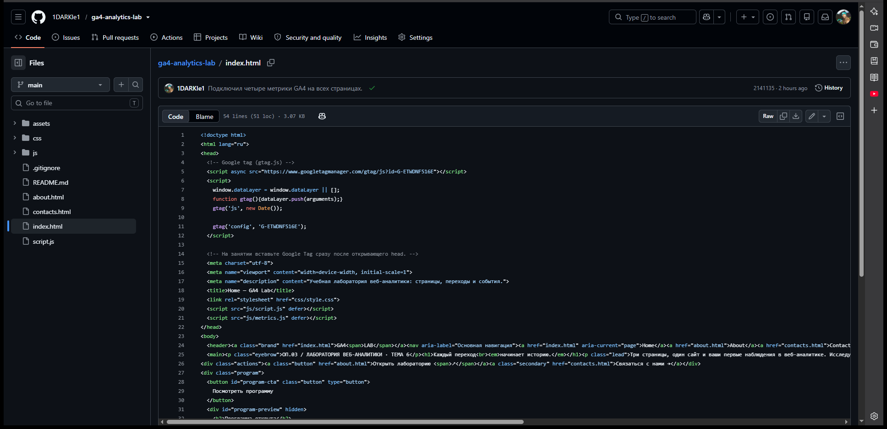

# Домашняя работа № 3 · Тег на сайте, источник и отчёты GA4

**Дисциплина:** ОП.03 «Информационные технологии»

| Поле | Значение |
|---|---|
| Фамилия, имя, отчество | Груздев Николай |
| Группа | РПО25/2 |
| Номер работы | 3 |
| Тема работы | Установка Google Tag, источник перехода и отчёты GA4 |
| Дата сдачи | 15.10 |
| Ветка | `hw-03` |

---

## 1. Мой сайт и мой ресурс

| Поле | Значение |
|---|---|
| Адрес репозитория сайта | https://github.com/1DARKle1/ga4-analytics-lab |
| Публичный адрес сайта | https://ga4-analytics-lab-gamma.vercel.app |
| Статус публикации | READY |
| Analytics Account | DARKle, 407429464 |
| Property | DARKle, 553435110 |
| Stream name | DARKle |
| Website URL в потоке | https://ga4-analytics-lab-gamma.vercel.app |
| Measurement ID (`G-…`) | G-ETWDNF516E |
| Страницы с тегом | index.html, about.html, contacts.html, guide.html |

Тег стоит в `head` по одному разу.

## 2. Тег установлен

**Результат проверки из инструкции тега:**

> Сообщение «На вашем сайте обнаружен тег Google» в этом заходе не появилось. На главной отчётов было «Данные с вашего сайта пока не получены», хотя в коде страницы идентификатор `G-ETWDNF516E` есть.



Кадр проверки «тег обнаружен» не приложен.

## 3. События доходят до аналитики

| Поле | Значение |
|---|---|
| Дата и время проверки | 16.10 |
| Какие страницы открывали | главная сайта и отчёт ресурса |
| Какие события появились в Realtime | лента Realtime не открылась |
| Число активных пользователей в момент проверки | на главной отчётов 0 |

Кадр Realtime с `page_view` не приложен.

## 4. Источник перехода определился

Ссылка собирается с метками `utm_source`, `utm_medium`, `utm_campaign`
и открывается на своём сайте.

**Ссылка целиком:**

```
https://ga4-analytics-lab-gamma.vercel.app/?utm_source=telegram&utm_medium=social&utm_campaign=ga4_lab
```

| Поле | Значение |
|---|---|
| Где в GA4 виден источник | отчёт по источникам в этом заходе не открылся |
| Какое значение источника показал GA4 | не показано |
| Совпадает с `utm_source` из ссылки | нет, значение в отчёте не снято |

Кадр источника не приложен.

## 5. Статистика на странице «Отчёты»

| Показатель | Значение | Период |
|---|---|---|
| Пользователи | 0 | последние 7 дней на главной отчётов |
| Сеансы | 0 | тот же период |
| События | 0 | тот же период |
| Самое частое событие | нет, событий не было | тот же период |

Кадр страницы «Отчёты» отдельным файлом не приложен. На главной ресурса были нули и текст, что данные с сайта ещё не получены.

**Что видно по этим числам** (2–3 предложения):

> Тег в коде опубликован, но отчёт за 7 дней ещё пустой. По этим нулям нельзя сказать, откуда приходят люди и какие страницы они открывают. Пока Realtime не покажет `page_view`, рано считать, что счётчик уже принимает визиты.

## 6. Что не получилось

Проверка «тег обнаружен», Realtime и источник по UTM не сняты. Открывалась главная отчётов, не лента в реальном времени. В коде страницы идентификатор `G-ETWDNF516E` виден, публикация сайта в статусе READY.

## 7. Использование ИИ

| Вопрос | Ответ |
|---|---|
| Что сделано самостоятельно | проверил код сайта и карточку ресурса GA4 |
| Что спрошено у модели | как оформить бланк и не написать, что тег обнаружен, если такого сообщения не было |
| Что после этого изменено | в бланке оставил только то, что видно в коде и на главной отчётов |
