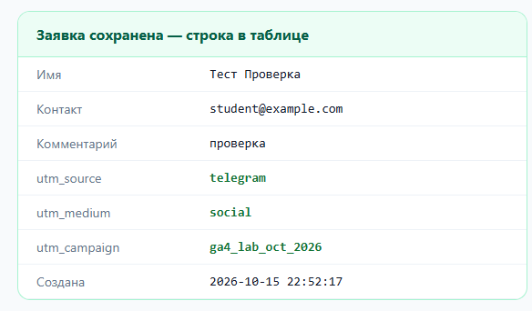
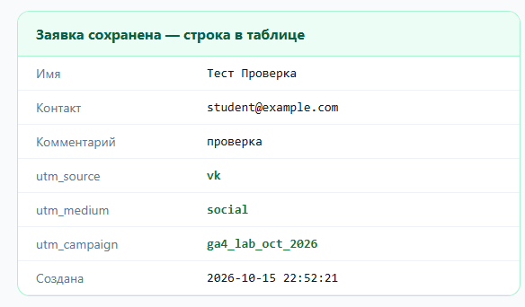
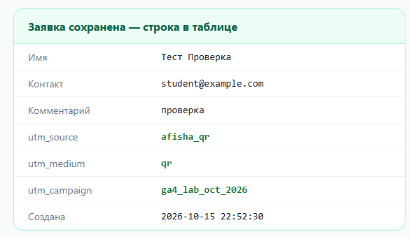
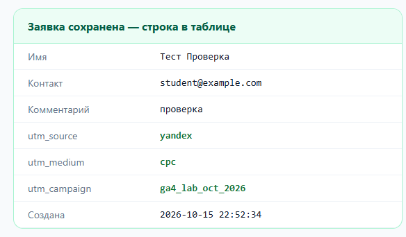
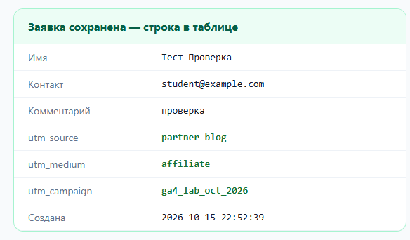
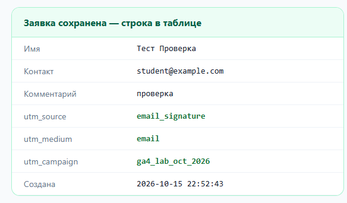
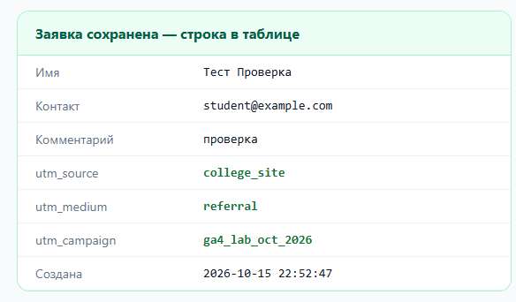
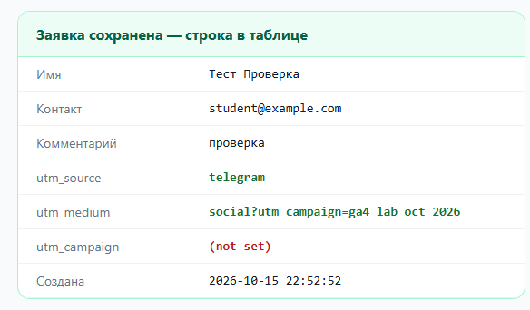

# Занятие 2. UTM-разметка

**Студент:** Груздев Николай, РПО25/2

**Дата:** 15.10

Проверка шла на учебном стенде из `materials/tema-03-utm-metki/stend`, отданном по адресу `http://localhost:8765/`. Каждая ссылка открывалась в Chrome, затем отправлялась форма. Значения `ep.*` взяты из запроса `g/collect.gif` с событием `generate_lead`.

Домашнее задание 1 по этой теме в конспекте названо `homework_02.md`, но это имя в репозитории уже занято бланком задания 2. Поэтому расширенный справочник на восемь каналов и разбор трёх реальных ссылок лежат здесь же, в разделах 1, 5 и 6.

## 1. Справочник меток

Кампания: открытие учебной лаборатории GA4 Lab в октябре 2026 года. У всех восьми строк `utm_campaign` одинаковый, каналы различаются первыми двумя столбцами.

| № | Канал | utm_source | utm_medium | utm_campaign |
|---|---|---|---|---|
| 1 | Пост в Telegram-канале группы | telegram | social | ga4_lab_oct_2026 |
| 2 | Пост в сообществе ВКонтакте | vk | social | ga4_lab_oct_2026 |
| 3 | Рассылка студентам колледжа | college_email | email | ga4_lab_oct_2026 |
| 4 | QR-код на печатной афише | afisha_qr | qr | ga4_lab_oct_2026 |
| 5 | Платное объявление в Яндекс Директе | yandex | cpc | ga4_lab_oct_2026 |
| 6 | Партнёрская ссылка в блоге | partner_blog | affiliate | ga4_lab_oct_2026 |
| 7 | Подпись в письме | email_signature | email | ga4_lab_oct_2026 |
| 8 | Ссылка со страницы колледжа (свой выбор) | college_site | referral | ga4_lab_oct_2026 |

Проверка по шести правилам: все значения строчные и латиницей, вместо пробела `_`, `utm_medium` только из списка (`qr` согласован отдельно), в `utm_campaign` есть повод и период, ссылки собраны из этой таблицы.

## 2. Собранные ссылки

1. Пост в Telegram-канале группы - `http://localhost:8765/?utm_source=telegram&utm_medium=social&utm_campaign=ga4_lab_oct_2026`
2. Пост в сообществе ВКонтакте - `http://localhost:8765/?utm_source=vk&utm_medium=social&utm_campaign=ga4_lab_oct_2026`
3. Рассылка студентам колледжа - `http://localhost:8765/?utm_source=college_email&utm_medium=email&utm_campaign=ga4_lab_oct_2026`
4. QR-код на печатной афише - `http://localhost:8765/?utm_source=afisha_qr&utm_medium=qr&utm_campaign=ga4_lab_oct_2026`
5. Платное объявление в Яндекс Директе - `http://localhost:8765/?utm_source=yandex&utm_medium=cpc&utm_campaign=ga4_lab_oct_2026`
6. Партнёрская ссылка в блоге - `http://localhost:8765/?utm_source=partner_blog&utm_medium=affiliate&utm_campaign=ga4_lab_oct_2026`
7. Подпись в письме - `http://localhost:8765/?utm_source=email_signature&utm_medium=email&utm_campaign=ga4_lab_oct_2026`
8. Ссылка со страницы колледжа - `http://localhost:8765/?utm_source=college_site&utm_medium=referral&utm_campaign=ga4_lab_oct_2026`

Для своего сайта адрес стенда заменяется на `https://ga4-analytics-lab-gamma.vercel.app/`, довесок остаётся тем же.

## 3. Проверка

В каждой строке адресная строка после загрузки совпала со ссылкой, знак `?` один, дальше только `&`, нет `%20` и `%D0`. В скрытых полях формы до отправки стояли те же три значения.

| № | ep.source | ep.medium | ep.campaign | Поля в заявке |
|---|---|---|---|---|
| 1 | telegram | social | ga4_lab_oct_2026 | да |
| 2 | vk | social | ga4_lab_oct_2026 | да |
| 3 | college_email | email | ga4_lab_oct_2026 | да |
| 4 | afisha_qr | qr | ga4_lab_oct_2026 | да |
| 5 | yandex | cpc | ga4_lab_oct_2026 | да |
| 6 | partner_blog | affiliate | ga4_lab_oct_2026 | да |
| 7 | email_signature | email | ga4_lab_oct_2026 | да |
| 8 | college_site | referral | ga4_lab_oct_2026 | да |

В каждом прогоне ушло два события: `page_view` при загрузке и `generate_lead` при отправке.

Кадры сохранённых заявок:

**Переход вглубь сайта.** Открыл стенд по ссылке 1 и перешёл по меню на «Программа курса». В адресе осталось `http://localhost:8765/programma.html`, без меток, а в скрытых полях сохранилось `telegram` / `social` / `ga4_lab_oct_2026`. Так работает первое касание: метки запомнились при первом заходе.

## 4. Намеренная поломка

Ссылка: `http://localhost:8765/?utm_source=telegram&utm_medium=social?utm_campaign=ga4_lab_oct_2026`

Что испортили: вместо `&` перед `utm_campaign` поставлен второй знак `?`.

Что изменилось в ep.*: `ep.source = telegram` не изменился. `ep.medium` стал `social?utm_campaign=ga4_lab_oct_2026`, то есть забрал в себя кусок соседней метки. `ep.campaign` стал `(not set)`.

Как это выглядело бы в отчёте: кампании `ga4_lab_oct_2026` в отчёте не будет совсем. Появится лишний канал со странным значением `social?utm_campaign=...`, который не попадёт ни в одну стандартную группу. В самом отчёте ошибку не видно, поэтому ссылку надо проверять до публикации.

## 5. Три реальные размеченные ссылки

Ссылки взяты из открытых постов Telegram 16.10.2026.

**Пост.** Канал Хабра, пост https://t.me/habr_com/69779, ссылка `https://habr.com/ru/news/1094246/?utm_source=telegram_habr`

| Правило | Оценка |
|---|---|
| строчные, латиница, `_` | соблюдено |
| три метки | нарушено: есть только `utm_source`, нет `utm_medium` и `utm_campaign` |
| `utm_medium` из списка | метки нет, переход уйдёт в канал по умолчанию |
| повод и период в `utm_campaign` | метки нет |

**Объявление.** Рекламный пост Сбера с меткой `erid`, https://t.me/sberbank/6430, ссылка `https://sberuniversity.ru/conferences/bcho2026/?utm_source=tg&utm_medium=paid&utm_campaign=bcho2026_09-10-2026&utm_content=sber_post?erid=2RanynF5efM`

| Правило | Оценка |
|---|---|
| строчные, латиница | соблюдено |
| `utm_medium` из списка | нарушено: `paid` вместо `cpc` |
| повод и период в `utm_campaign` | соблюдено: `bcho2026` и дата `09-10-2026` |
| один знак `?` | нарушено: перед `erid` стоит второй `?`. Значение `utm_content` станет `sber_post?erid=2RanynF5efM`, а отдельного параметра `erid` в адресе не будет. Это та же ошибка, что в разделе 4 |

**Третья ссылка.** Пост РБК, https://t.me/rbc_news/158784, ссылка `https://www.rbc.ru/industries/news/6ac7b1b89a7947ee10aa79bf?utm_source=ss_tg_rbc&utm_medium=rbc&utm_campaign=ss_tg_rbc&erid=2SDnjeykg1y`

| Правило | Оценка |
|---|---|
| строчные, латиница, `_` | соблюдено |
| `utm_medium` из списка | нарушено: `rbc` это имя издания, а не способ доставки. Нужно `social` |
| повод и период в `utm_campaign` | нарушено: `utm_campaign` повторяет `utm_source`, повода и периода нет |
| один знак `?` | соблюдено, `erid` отделён через `&` |

Рассылку найти не удалось. В открытом архиве писем Mailchimp ссылки в письмах лежат без меток: сервис дописывает их только в момент клика. Поэтому третьей взята ещё одна ссылка из поста, а не из рассылки.

## 6. Использование ИИ

Справочник и ссылки составил сам, проверку на стенде провёл своим запуском Chrome, значения `ep.*` взял из запросов. Реальные ссылки выписал из постов как есть. Модель помогла оформить таблицы.
