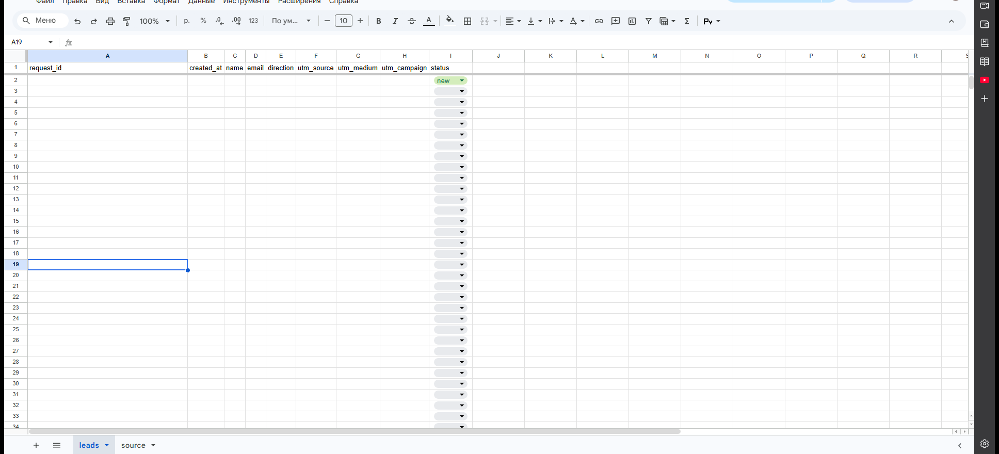
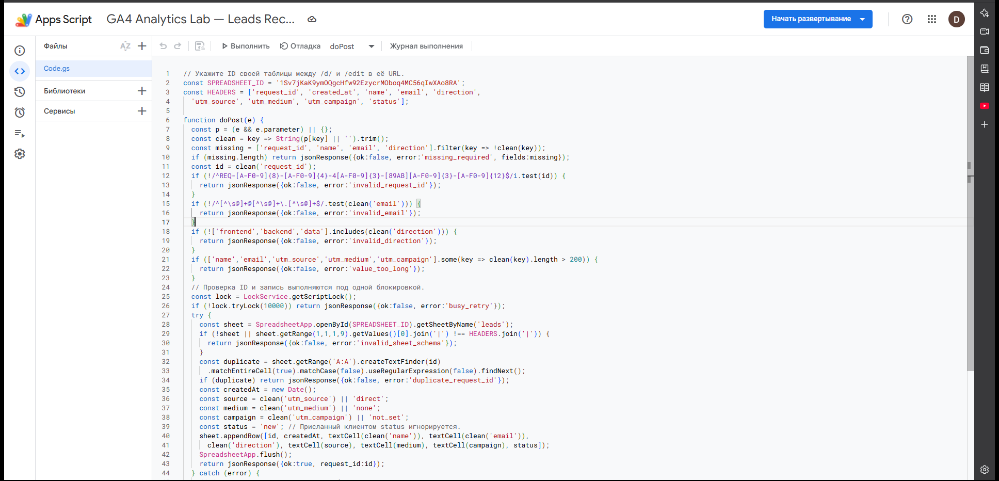
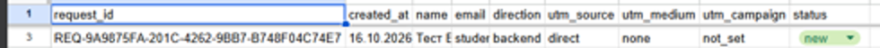
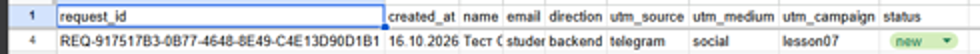

# Домашняя работа № 5 · Контролируемая таблица заявок

**Дисциплина:** ОП.03 «Информационные технологии»

| Поле | Значение |
|---|---|
| Фамилия, имя, отчество | Груздев Николай |
| Группа | РПО25/2 |
| Номер работы | 5 |
| Тема работы | Форма сайта → Apps Script → Google Таблица заявок |
| Дата сдачи | 15.10 |
| Ветка | `hw-05` |

---

## 1. Таблица

Я создал таблицу «GA4 Analytics Lab — Leads» с листом `leads`. В первой
строке девять заголовков: `request_id`, `created_at`, `name`, `email`,
`direction`, `utm_source`, `utm_medium`, `utm_campaign`, `status`. Строка
заголовков закреплена, у статуса список из четырёх значений: `new`,
`in_progress`, `done`, `rejected`. Два правила подсвечивают неполную строку
и повторный `request_id`.

Ссылка на таблицу (доступ открыт только преподавателю): https://docs.google.com/spreadsheets/d/1Sv7jKaK9ymOQgcHfw92EzycrMOboq4MC56qIwXAo8RA/edit

## 2. Приёмник и форма

Я вставил `Code.gs` из материалов в Apps Script, указал ID своей таблицы
и опубликовал проект как Web app. Форму в `contacts.html` заменил
фрагментом из материалов, в `action` поставил адрес своего Web app,
обработчик формы в `js/script.js` заменил новым.

| Мои данные | Значение |
|---|---|
| Публичный адрес сайта | https://ga4-analytics-lab-gamma.vercel.app |
| Measurement ID (`G-…`) | G-ETWDNF516E |
| Коммит с новой формой (первые 7 символов) | fb38a16 (форма и обработчик), c5d5d8c (адрес Web app в `action`) |
| Развёртывание Web app | «Приём заявок с сайта GA4 Analytics Lab», версия 2 от 14.10.2026 |
| Адрес Web app | https://script.google.com/macros/s/AKfycbyGRN-zjHzIn-CoqfxGUQ5T3tGGMj42MPvDWAoYeC0XIuiBMF5PZvBe6lrw_pSfWbC1/exec |

Скриншот: вставьте строку ``

Скриншот: вставьте строку ``

## 3. Две тестовые заявки

Первую заявку я отправил со страницы без меток: в таблице записалось
`direct` / `none` / `not_set` и статус `new`. Вторую отправил по ссылке
с метками `telegram` / `social` / `lesson07`, и они записались в свои
столбцы.

| | Заявка без меток | Заявка с метками |
|---|---|---|
| `request_id` | REQ-9A9875FA-201C-4262-9BB7-B748F04C74E7 | REQ-917517B3-0B77-4648-8E49-C4E13D90D1B1 |
| Адрес страницы | https://ga4-analytics-lab-gamma.vercel.app/contacts.html | https://ga4-analytics-lab-gamma.vercel.app/contacts.html?utm_source=telegram&utm_medium=social&utm_campaign=lesson07 |
| Строка в листе `leads` | 3 | 4 |

## 4. Событие в аналитике

После отправки в GA4 пришло событие `generate_lead`. Оно показывает
попытку отправки формы, а сама заявка подтверждается строкой в таблице.

По запросам к `google-analytics.com/g/collect` при отправке ушли: без меток `page_view`, `scroll`, `generate_lead`; с метками ещё `utm_visit`.

Скриншот: вставьте строку ``

## 5. Проверки

| Проверка | Что сделал | Ответ приёмника |
|---|---|---|
| Пустое имя | отправил заявку без `name` | `{"ok":false,"error":"missing_required","fields":["name"]}`, строка не добавилась |
| Повтор с тем же `request_id` | ещё раз отправил оба `request_id` | `{"ok":false,"error":"duplicate_request_id"}` для каждого, новых строк нет |
| Статус от клиента | прислал `status=finished` | приёмник поле `status` не читает, статус `new` ставит сам сервер |

Скриншот: вставьте строку ``

Скриншот: вставьте строку ``

---

Не получилось: кадры окна развёртывания, формы, события в GA4, подсвеченного дубля и отказа статуса ещё не сняты. Подсветку дубля и смену статуса через список в самой таблице я руками не проверял. Во второй строке листа есть старая строка с `#REF!` в `created_at`, она появилась до тестовых заявок.

ИИ: использовал для оформления бланка. `request_id` и ответы приёмника взяты из моих тестовых отправок.
